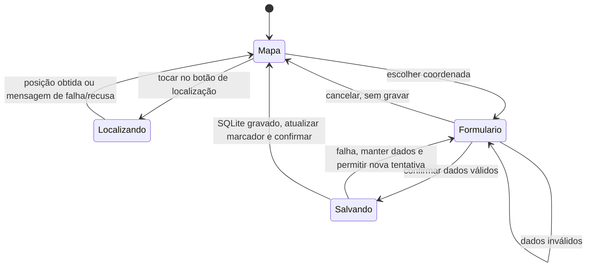

# Aula 2 — MapPin: implementar e projetar os testes

**Disciplina:** Laboratório de Desenvolvimento de Aplicativos Nativos

**Professor:** Lucas Hermenegildo do Nascimento

**Etapa:** P2, trabalho em dupla

**Aula:** 08/10/2026 · **Atualização:** 22/10/2026

## Equipe e ambiente

| Integrante | Matrícula |
| --- | --- |
| Lucas de Souza Cardia | 202312499 |
| Carlos Eduardo de Oliveira Curti | 202312587 |

Repositório: [Kadu9129/ProjetoNativo](https://github.com/Kadu9129/ProjetoNativo).

O MapPin é um mapa pessoal para guardar e reencontrar lugares, sem cadastro de conta. A tecnologia existente foi mantida: JavaScript, Expo SDK 54, React Native 0.81.5, React 19.1, `expo-location` 19 e `expo-sqlite` 16. Android e iOS usam a integração nativa; a versão web é complementar. O banco `mappin.db` fica no dispositivo.

Ambiente de preparação: Windows, Node.js 24.11.0 e npm 11.6.1. O ambiente e a versão de cada execução estão registrados na planilha e em [evidências](evidencias/README.md). Não se presume validação em iPhone ou aparelho físico a partir dos testes de serviço ou do emulador.

## Primeiro fluxo

**RF01 — Salvar e consultar um lugar no dispositivo:** o usuário deve poder escolher uma coordenada no mapa, informar nome e descrição e confirmar a gravação local. A localização atual é um auxílio opcional para centralizar o mapa. Recusar a permissão não impede a seleção manual. Cancelar ou falhar não pode ser apresentado como uma gravação bem-sucedida.

**Critério de aceite:** começando com N lugares, preencher dados válidos e confirmar deve fechar o formulário, apresentar “Lugar salvo neste dispositivo.”, mostrar o marcador e permitir encontrá-lo pela busca, com N+1 lugares. Após fechar e reabrir, o registro mantém nome, descrição e coordenadas. Cancelar mantém N e os dados anteriores. Dados inválidos ou falha de gravação mantêm o formulário e apresentam erro, sem confirmação de sucesso.

Regras verificáveis:

- Nome obrigatório, de 1 a 100 caracteres após remover espaços nas extremidades.
- Descrição obrigatória, de 1 a 500 caracteres após remover espaços nas extremidades.
- Latitude entre -90 e 90; longitude entre -180 e 180; ambas numéricas e finitas.
- A interface limita os campos a 100 e 500 caracteres. A camada de validação também rejeita valores acima desses limites recebidos diretamente.
- Nenhum registro é criado por solicitar localização, negar permissão ou simplesmente abrir o formulário.

Sequência demonstrável:

1. Abrir o MapPin. A abertura não solicita permissão de localização.
2. Opcionalmente tocar em **Ir para minha localização** e conceder a permissão durante o uso.
3. Tocar num ponto livre do mapa. A coordenada escolhida aparece em **Novo lugar**.
4. Informar nome e descrição e tocar em **Salvar lugar**.
5. Verificar confirmação, contador e marcador; pesquisar o nome na busca.
6. Fechar e reabrir o aplicativo para verificar a persistência.



## Recurso nativo e alternativas

**Localização:** `MapScreen.js` chama `locateUser`, em `src/services/locationFlow.js`, usando `expo-location`. O fluxo consulta a permissão atual e só solicita acesso em primeiro plano quando necessário. Não pede localização em segundo plano. O resultado centraliza o mapa; o usuário ainda escolhe o ponto e confirma o cadastro.

| Condição | Comportamento |
| --- | --- |
| Permissão concedida | Obtém e valida coordenadas e centraliza o mapa. |
| Permissão negada | Informa a recusa e mantém o cadastro manual disponível. |
| Permissão permanentemente bloqueada | Orienta as configurações e oferece atalho no Android/iOS. Após habilitar, o usuário tenta novamente. Na web, usa as configurações de permissão do site. |
| GPS desligado | Informa que o serviço está desligado e orienta ativação ou seleção manual. |
| Provedor demora | Após 15 segundos aguardando a posição, informa demora e libera nova tentativa. Resposta tardia não é aplicada à tela. O diálogo de permissão depende da decisão do usuário e não usa esse limite. |
| Falha ou coordenada inválida | Informa indisponibilidade e não cria uma localização de sucesso. |
| Cancelamento do formulário | Descarta o rascunho. Ao editar, preserva os valores já gravados. |
| Falha de gravação | Apresenta erro e mantém os campos para recuperação. |

O prazo de 15 segundos encerra a espera da aplicação; não é uma API de cancelamento físico do GPS. A permissão no Expo Go pertence ao aplicativo hospedeiro. A mensagem própria de permissão do iOS exige novo build nativo para aparecer.

**Limites da localização na web:** a versão instalada de `expo-location` não distingue bloqueio permanente por `canAskAgain` e só verifica se o navegador oferece geolocalização, sem detectar o estado real do GPS. A solicitação inicial de permissão do navegador também ocorre antes do prazo de 15 segundos da busca de posição. Por isso, CT06 e CT07 têm alvo Android/iOS; a tabela acima descreve as alternativas nativas, e não uma equivalência completa entre plataformas. As execuções web desta entrega verificaram formulário e persistência, sem conceder acesso à localização real do computador.

**Persistência nativa:** `pinDatabase.js` grava no SQLite, com validações em `pinModel.js`. Os registros locais não dependem de um servidor. O fundo do OpenStreetMap e, no Android, o carregamento inicial do mapa externo podem precisar de internet. A implementação nativa oferece uma grade local quando o mapa externo não carrega. No Expo Go, reabrir sem acesso ao Metro pode bloquear a carga do JavaScript, mesmo com os dados preservados; o teste offline completo deve ser repetido no APK instalado.

Referência da API: [Expo Location](https://docs.expo.dev/versions/latest/sdk/location/). As chamadas utilizadas foram conferidas também nas declarações da versão instalada no projeto. O exemplo de câmera do material da aula é ilustrativo; esta entrega usa localização e SQLite, os recursos já adotados pelo MapPin.

## Projeto dos testes

A [planilha preenchida](testes/Aula_2_Projeto_e_Documentacao_de_Testes.xlsx) mantém as sete abas do modelo: Projeto, Tecnicas, Casos, Execucoes, Defeitos, Documentacao e Exemplo. A aba Exemplo permanece apenas como referência do professor e não conta como teste do MapPin.

| ID | Técnica e justificativa | Derivação e casos |
| --- | --- | --- |
| T01 | **Particionamento de equivalência.** Permissões, disponibilidade do recurso e validade dos dados têm classes com comportamentos distintos. | Concedida (CT01), negada (CT02), obrigatórios inválidos (CT04), bloqueada (CT06), GPS desligado (CT07), falha/timeout (CT08) e armazenamento indisponível (CT12). |
| T02 | **Transição de estados.** O cadastro e a edição têm rascunhos que só se tornam persistentes após confirmar. É necessário verificar retornos e reabertura. | Formulário → cancelar → mapa sem novo lugar (CT03); edição → cancelar → dados originais (CT05); salvo → app fechado → reaberto sem internet → mesmos dados (CT11). |
| T03 | **Análise de valor limite.** Os limites já definidos pelo aplicativo geram testes nas bordas e nos valores vizinhos. | Nome: 0, 1, 99, 100 e 101 caracteres (CT09). Descrição: 0, 1, 499, 500 e 501 (CT10). A UI trunca a entrada excedente; o serviço rejeita o valor excedente direto. |

Os 12 casos têm IDs estáveis, RF01, pré-condições, dados fictícios, passos numerados, resultado esperado, prioridade e aula de criação. Os testes funcionais e de integração são focos dos testes; as técnicas de derivação são as três acima.

Os casos foram preparados com auxílio do Codex para a dupla. O campo de executor identifica quem efetivamente conduziu cada execução; nenhum teste é atribuído a Lucas ou Carlos sem execução informada por eles.

Para reproduzir CT08 e CT12 sem danificar um banco real, consultar o [roteiro de falhas controladas](testes/falhas-controladas.md). As alterações de simulação são temporárias, em uma cópia de teste, e devem ser registradas junto da versão da execução.

## Como reproduzir

Na raiz do repositório:

```bash
npm ci
npm test
npm run dev:frontend
```

Para usar Android, iniciar um emulador compatível e pressionar `a` no Expo, ou abrir o projeto pelo Expo Go compatível com SDK 54. No emulador, configurar uma posição fictícia; com ADB disponível:

```bash
adb emu geo fix -46.633308 -23.55052
```

O comando recebe **longitude antes de latitude**. Usar uma instalação de teste e anotar a quantidade inicial de lugares. Os casos não exigem limpar os dados do usuário. Para testar a primeira concessão/recusa, usar uma instalação de teste sem decisão de permissão ou redefinir somente a permissão nessa instalação. Registrar as condições efetivamente utilizadas.

Para gerar e servir a versão web:

```bash
npm run build:web
npm run serve:web --workspace frontend
```

O servidor usa `frontend/serve.json` para fornecer os cabeçalhos exigidos pelo SQLite no navegador. Em máquinas com poucos recursos, a exportação pode ser feita com `npx expo export --platform web --max-workers 2` dentro de `frontend`, seguida de `npx workbox generateSW workbox-config.js`.

## Execuções e evidências

Consultar [o registro de execuções](evidencias/README.md) e a aba **Execucoes** para ambiente, versão, resultados e caminhos das evidências. Os caminhos na planilha são relativos à pasta `docs/testes/`.

**Testes automatizados complementares:** `npm test` cobre concessão/recusa/bloqueio de localização com provedor simulado, GPS desligado, timeout, erros, validação de campos e limites, persistência SQLite e disponibilidade do mapa. Esses testes não demonstram sozinhos renderização, diálogos do sistema ou interação com GPS real.

**Execuções na interface:** somente os passos efetivamente observados devem constar como aprovados. Capturas e relatos identificados por EXxx ficam em `docs/evidencias/`. Casos pendentes ou bloqueados continuam com essa situação na planilha. Não confundir o número de casos documentados com o número de execuções aprovadas.

## Defeitos e pendências

A aba **Defeitos** registra **DF01**, originado de **EX05**: ao fechar e reabrir a aba web, o banco local não abriu e “Tentar novamente” também falhou. Um recarregamento posterior recuperou os dois lugares. A causa ainda não foi confirmada; não houve evidência de perda definitiva dos dados. Situação: **Aberto**, severidade **Média**, investigação pendente da dupla. A recuperação por recarregamento não é uma correção validada.

O bloqueio Android em EX01 corresponde ao Expo Go sem responder e não foi classificado como defeito do MapPin. Após corrigir DF01, criar outra execução e preservar EX05; usar “Validado” somente depois da reexecução completa.

Pendências de validação: aparelho físico, iOS, APK atualizado e teste offline completo sem dependência do Metro. A simulação unitária de erro do GPS não substitui o teste correspondente na interface; o cenário de falha SQLite depende de ambiente controlado e deve permanecer pendente se não for reproduzido.

## Evolução

Base anterior: [9fd2408](https://github.com/Kadu9129/ProjetoNativo/commit/9fd2408). A [branch da entrega](https://github.com/Kadu9129/ProjetoNativo/tree/codex/aula-2-testes) contém o [fluxo e os testes](https://github.com/Kadu9129/ProjetoNativo/commit/6343d113f2dd19dcb94407bebcee2d463f9a9d83) e a [configuração validada do servidor web](https://github.com/Kadu9129/ProjetoNativo/commit/8d7bf3f6e1e322cf9d91f9b482909091abdd586d). O registro de evidências identifica o commit de cada execução.

Mudanças da Aula 2: localização solicitada por ação do usuário, tratamento de bloqueio permanente, GPS desligado, timeout e resposta inválida; mensagem de permissão iOS em português; ampliação dos testes automatizados; requisito e critérios de aceite; planilha adaptada ao MapPin.

O APK e o ZIP anteriores em `artifacts/` são versões históricas e não devem ser apresentados como build desta atualização.

Até a Aula 4, os 12 casos já documentados superam a meta de oito. O próximo trabalho é executar os pendentes em dispositivo/versão identificados, testar o APK offline, registrar defeitos encontrados e acrescentar reexecuções sem apagar o histórico.
